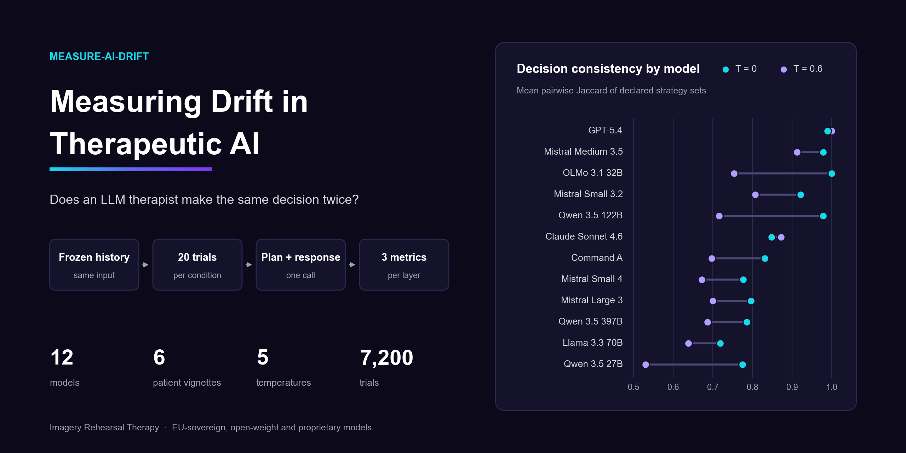
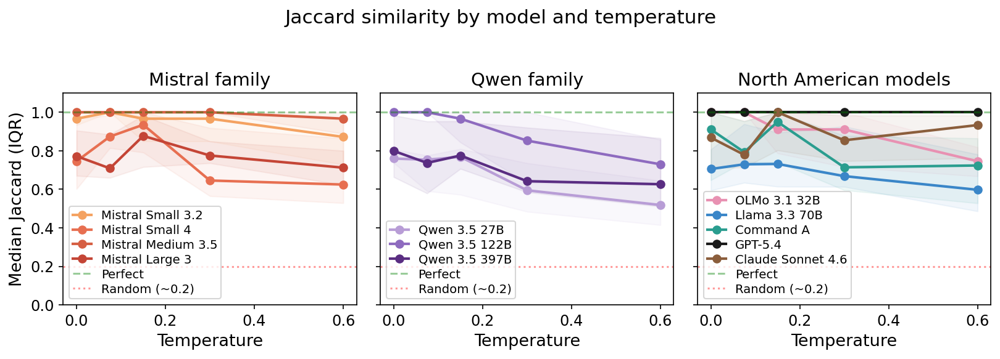
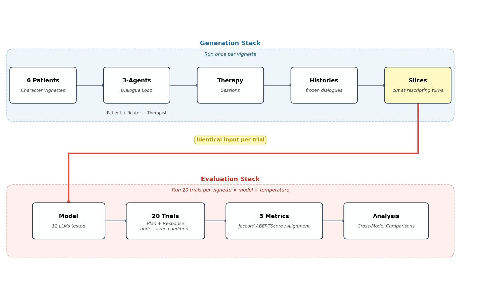
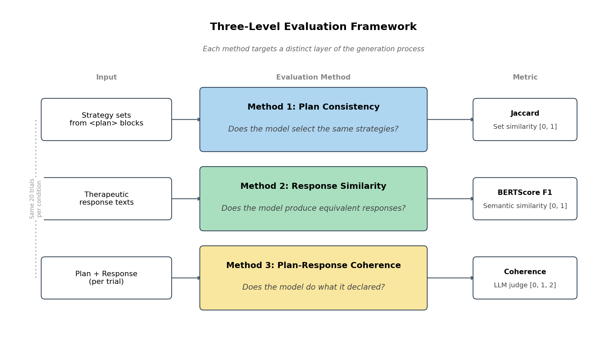

# Measure-AI-Drift

**Does an LLM therapist make the same decision twice?**

This repository holds the code, data and paper for *Measuring Drift in Therapeutic AI*. The study measures how consistent LLM responses are across independent runs when the model is given the same patient context within a structured therapy protocol, Imagery Rehearsal Therapy (IRT) for nightmares. It compares EU-sovereign, open-weight and proprietary models. The deployment context is [reDreamAI](https://redreamai.com), an IRT chatbot.

Paper: [`paper/main.pdf`](paper/main.pdf)

## Key results

The design crosses 12 models, 6 patient vignettes, 5 temperatures and 20 trials per condition, 7,200 trials in total.

- Decision stability differs strongly between models: median Jaccard ranges from 0.69 to 1.00.
- Stability depends on the model (η² = 0.29), not on how difficult the patient is. The vignette effect is not significant.
- Wording drifts about twice as fast with temperature as decisions do (ρ = −0.49 for BERTScore, −0.22 for Jaccard).
- Greedy decoding is not the most stable setting. 10 of 12 models are most consistent at a non-zero temperature.
- Models implement what they declare. Alignment is near ceiling and does not change with temperature.
- Mistral Medium 3.5, an EU-sovereign open-weight model, is the most stable model overall.



## How it works

The system has two separate stacks, so that randomness in the patient or router cannot leak into the measurement.

1. **Generation stack.** A patient agent, a router and a therapist agent produce one synthetic IRT session per vignette. The session is cut at rescripting-turn boundaries and frozen.
2. **Evaluation stack.** The model under test receives the identical frozen history twenty times per condition. Any variation between trials comes from the model itself.



Each trial is one fused call. The model first declares one or two strategies from a fixed six-category taxonomy, then writes its response. An illustrative example:

```
<plan>confrontation / cognitive_reframe</plan>
You mentioned the figure at the door never speaks. If you could turn around and ask it one question, what would it be?
```

Because the plan is written down, the clinical decision can be compared across trials. Stability is measured on three levels.

| Level | Question | Metric |
|---|---|---|
| Plan consistency | Do the strategy selections repeat? | Pairwise Jaccard over declared strategy sets |
| Response similarity | Do the texts convey the same meaning? | Pairwise BERTScore F1 (DeBERTa-XLarge-MNLI) |
| Plan–response alignment | Does the model do what it declared? | LLM judge (Gemini 3 Flash), validated against human annotation (κ = 0.78) |



## Models

| Model | Size | License |
|---|---|---|
| Mistral Small 3.2 | 24B dense | Apache 2.0 |
| Mistral Small 4 | 119B MoE | Apache 2.0 |
| Mistral Medium 3.5 | 128B dense | modified MIT |
| Mistral Large 3 | 675B MoE | Apache 2.0 |
| Qwen 3.5 27B / 122B / 397B | dense / MoE / MoE | Apache 2.0 |
| OLMo 3.1 32B | 32B dense | Apache 2.0 |
| Llama 3.3 70B | 70B dense | Llama license |
| Command A | 111B dense | CC-BY-NC |
| GPT-5.4 | undisclosed | proprietary |
| Claude Sonnet 4.6 | undisclosed | proprietary |

All models run in non-thinking mode at T ∈ {0.0, 0.075, 0.15, 0.3, 0.6}. Model IDs, providers and reasoning settings are in [`src/config/models.yaml`](src/config/models.yaml). Mistral Large 4 was collected on its public preview and is reported outside the model set (Appendix I of the paper).

## Repository layout

| Path | Content |
|---|---|
| `src/` | Agents, generation stack, evaluation stack, metrics, CLI |
| `src/config/` | Model registry and experiment settings |
| `data/prompts/` | Patient vignettes, stage prompts, strategy taxonomy, judge rubric |
| `scripts/` | Experiment runners and re-judging tools |
| `stats/data/` | Aggregated per-run results (`experiment_runs.csv`, 360 runs) and test outputs |
| `stats/scripts/` | Descriptives, tests and figure scripts |
| `paper/` | LaTeX source and PDF of the paper |
| `thesis/figures/` | Generated figures |
| `docs/` | Analysis notes, model and temperature sources, style guide |

## Getting started

Requires Python 3.10 or newer and [uv](https://docs.astral.sh/uv/).

```bash
uv sync
uv run python -m src test-setup     # verify the installation
uv run python -m src keys           # check which API keys are configured
uv run python -m src list-models    # show the model registry
```

API keys go into a `.env` file in the repository root. The pipeline reads `OPENROUTER_API_KEY` (most models), `OPENAI_API_KEY` (GPT-5.4) and `GOOGLE_AI_STUDIO_API_KEY` (judge).

### Run the pipeline

```bash
# 1. Generate a synthetic session and freeze it
uv run python -m src generate --vignette cooperative --freeze

# 2. Evaluate one condition
uv run python -m src evaluate --history <frozen_history.json> \
    --model mistral_medium35 --temperature 0.15 --trials 20

# 3. Full experiment: all models × vignettes × temperatures
./scripts/run_full_experiment.sh
```

The full experiment calls paid APIs for 7,200 trials plus judging. The frozen histories and per-trial raw outputs of the study are not in the repository and are available from the author on request.

### Reproduce the statistics and figures

The per-run data in `stats/data/` are enough to recompute the statistics and the data figures of the paper.

```bash
uv run python stats/scripts/descriptives.py
uv run python stats/scripts/tests.py
./scripts/build_paper.sh --figs     # regenerate figures and build paper/main.pdf
```

A new model needs one entry in `src/config/models.yaml`. The metric, aggregation and test code stay as they are.

## Early test runs

The project started with a small prototype on Llama 3.3 70B before the final model set existed. Two questions from that phase shaped the design.

The first was how to produce plan and response. In *fused* mode both come from one call, in *chained* mode the plan is generated first and injected into a second call. The prototype compared both per vignette, and the study uses fused mode throughout.


The second was whether the three metrics separate models at all. This is the first comparison in fused mode, on models that are not the final ones.


Two trials from the same condition show what the raw data looked like. Both declare the same plan and word the response differently.


```json
{
  "temperature": 0.5,
  "plan": "<plan> empowerment / mastery </plan>",
  "response": "You're considering the possibility of either seeing who's entering the room or being able to move. That could significantly change the dynamics of the situation. If you could move, where would you go or what would you do as the door opens?",
  "strategies": ["empowerment", "mastery"]
}
```

These trials still use the early goal-level labels. A single broad "empowerment" category absorbed 87.7% of all picks, which is why the final taxonomy describes rescripting mechanisms instead. The four iterations are documented in [`docs/strategy_taxonomy_evolution.md`](docs/strategy_taxonomy_evolution.md).

## Limitations

All patient interactions are simulated, and the study covers one phase (rescripting) of one protocol at one conversation depth. The results measure computational consistency, not clinical safety or efficacy.

## Author

Daniel Menzel, Institute of Cognitive Science, University of Osnabrück.
