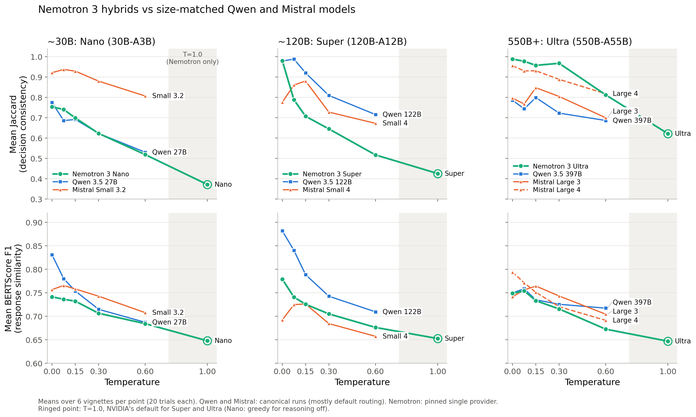
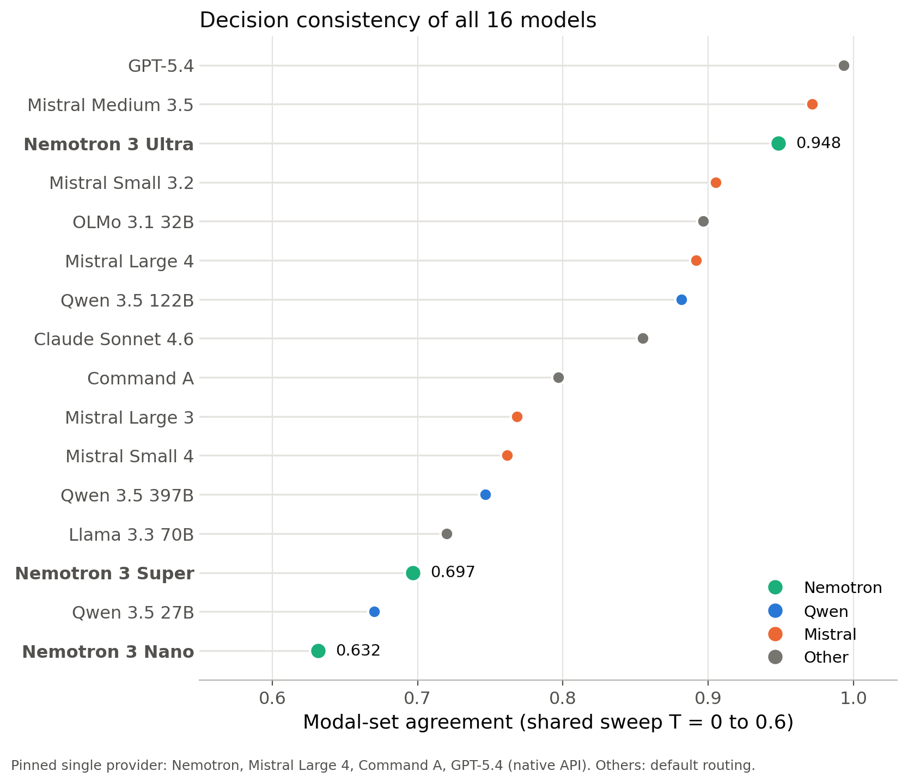

# Nemotron 3 test: do Mamba-Transformer hybrids behave differently?

> **Status:** exploratory, branch `24_Nemotron`, not part of the paper. Collected 2026-10-23.
> **Data:** `stats/data/nemotron_runs.csv` (108 runs, 2,160 trials). Tables: `stats/scripts/nemotron_compare.py`.

## Short answer

Not as a class. Nemotron 3 Ultra ranks third of 16 models on decision consistency, between Mistral Medium 3.5 and Mistral Small 3.2. Super and Nano sit at the bottom, next to Qwen 3.5 27B and Llama 3.3 70B. What the three share is the temperature profile:

- All three are most consistent at T=0 and decline steadily. None shows the low-temperature optimum of the Mistral family.
- Their decisions react to temperature almost as strongly as their wording. In the 13-model set wording reacts far more strongly than decisions.
- T=1.0 is the least consistent setting for all three. It is NVIDIA's recommendation for Super and Ultra in every mode, including reasoning off. Nano's card uses greedy decoding for reasoning off, so Nano's own default is T=0.

The three models share NVIDIA's training recipe as well as the architecture, so this test cannot attribute the temperature profile to the Mamba layers.

## Setup

| Model | Architecture | Endpoint (pinned) | Cost |
|---|---|---|---|
| Nemotron 3 Ultra | 550B-A55B LatentMoE, Mamba-2 + MoE + attention | `:free` variant, NVIDIA (quantisation undisclosed) | free |
| Nemotron 3 Super | 120B-A12B LatentMoE, Mamba-2 + MoE + attention | DeepInfra bf16 (the free NVIDIA endpoint was down) | paid |
| Nemotron 3 Nano | 30B-A3B MoE, Mamba-2 + MoE + attention | Nebius fp8 (no free variant) | paid |

Total OpenRouter spend for the batch, smoke test and checks: $0.17. Wall clock 1 h 32 min with the three models in parallel.

Changes to the run concept:

- **T=1.0 added.** The Super and Ultra cards recommend T=1.0 with top_p=0.95 for every mode, and their reasoning-off examples use exactly that. The Nano card recommends T=1.0 for reasoning, 0.6 for tool calling, and greedy decoding in its reasoning-off example. T=1.0 was run for all three for comparability. The pipeline does not send top_p, so the provider default applies (1.0, or the model's 0.95 if the server reads its generation config), and the T=1.0 runs may be more random than NVIDIA's setting. Each model runs the standard sweep (0.0 to 0.6) plus T=1.0 through the existing `therapy_temp` mechanism: 6 vignettes × 6 temperatures × 20 trials = 720 trials per model. All comparisons with the 13-model set use the five shared temperatures only.
- **Resumable driver.** `scripts/run_nemotron.py` skips finished conditions, deletes a failed one and retries with backoff, and touches only its own model's runs, so the models can run in parallel. Retries needed: Super one upstream 429, Ultra two responses the client could not read (`'NoneType' object is not subscriptable`) from the free endpoint. Both conditions succeeded on retry.

Non-reasoning mode works on all three endpoints. Direct calls with `reasoning.effort: "none"` return 0 reasoning tokens, and the same calls with reasoning enabled return 54–75. In the runs, completion lengths are 90–114 tokens on average, the range of Large 4's non-reasoning runs. No trial contains a think trace. Every trial was served by its pinned provider (720 of 720 each).

## Results





Figures: `stats/scripts/fig_nemotron.py`. Colours are figure-specific (one per family) because the paper's per-model colours fail the colour-blindness check when Qwen and Mistral share a panel.

### Ranking on the shared sweep

| Model | Median J | Mean J | Modal agreement (rank of 16) | BERTScore | Alignment | ρ(J, T) |
|---|---|---|---|---|---|---|
| GPT-5.4 | 1.000 | 0.992 | 0.993 (1) | 0.758 | 1.000 | +0.08 |
| Mistral Medium 3.5 | 1.000 | 0.967 | 0.972 (2) | 0.816 | 0.961 | −0.31 |
| **Nemotron 3 Ultra** | 1.000 | 0.941 | 0.948 (3) | 0.725 | 0.965 | −0.48 |
| Mistral Small 3.2 | 1.000 | 0.895 | 0.905 (4) | 0.746 | 0.917 | −0.23 |
| Mistral Large 4 | 1.000 | 0.905 | 0.892 (6) | 0.746 | 0.963 | −0.31 |
| Qwen 3.5 122B | 1.000 | 0.883 | 0.882 (7) | 0.793 | 0.978 | −0.56 |
| Mistral Small 4 | 0.814 | 0.784 | 0.762 (11) | 0.697 | 0.810 | −0.22 |
| Llama 3.3 70B | 0.696 | 0.725 | 0.720 (13) | 0.734 | 0.889 | −0.16 |
| **Nemotron 3 Super** | 0.724 | 0.728 | 0.697 (14) | 0.725 | 0.928 | −0.70 |
| Qwen 3.5 27B | 0.727 | 0.661 | 0.670 (15) | 0.753 | 0.946 | −0.49 |
| **Nemotron 3 Nano** | 0.632 | 0.667 | 0.632 (16) | 0.720 | 0.865 | −0.48 |

Super's ρ=−0.70 is the steepest decision-level temperature trend of all 16 models (next: OLMo 3.1 32B, −0.65). The full 16-model table, including the pinned bridge runs, is printed by the script.

### Size-matched peers

Run-level Jaccard, Mann–Whitney, Holm-corrected over all 24 planned comparisons (Jaccard and BERTScore against four peers per model).

| Nemotron | Peer (total size) | Mean J, Nemotron vs peer | p (Holm) |
|---|---|---|---|
| Nano (30B) | Qwen 3.5 27B, default routing | 0.667 vs 0.661 | 1.000 |
| | Qwen 3.5 27B, pinned (bridge) | 0.667 vs 0.994 | <.001 |
| | Mistral Small 3.2 (24B) | 0.667 vs 0.895 | .001 |
| | OLMo 3.1 (32B) | 0.667 vs 0.899 | <.001 |
| Super (120B) | Mistral Small 4 (119B), default / pinned | 0.728 vs 0.784 / 0.764 | 1.000 / 1.000 |
| | Qwen 3.5 122B, default / pinned | 0.728 vs 0.883 / 0.891 | .037 / .029 |
| Ultra (550B) | Mistral Large 4 (1.05T) | 0.941 vs 0.905 | 1.000 |
| | Mistral Large 3 (675B), default / pinned | 0.941 vs 0.783 / 0.864 | .001 / .140 |
| | Qwen 3.5 397B | 0.941 vs 0.748 | .007 |

Nano is as unstable as Qwen 3.5 27B under default routing, but its runs were pinned to one provider. Pinned, Qwen 27B reaches the ceiling. Super is level with Mistral Small 4 and below Qwen 122B. Ultra is level with Large 4 and above Qwen 397B.

### Temperature

Mean Jaccard per temperature (T=1.0 for Nemotron only):

| Model | 0.0 | 0.075 | 0.15 | 0.3 | 0.6 | 1.0 |
|---|---|---|---|---|---|---|
| Nemotron 3 Nano | 0.754 | 0.741 | 0.699 | 0.623 | 0.519 | 0.371 |
| Nemotron 3 Super | 0.981 | 0.788 | 0.707 | 0.645 | 0.517 | 0.426 |
| Nemotron 3 Ultra | 0.989 | 0.978 | 0.958 | 0.968 | 0.813 | 0.622 |
| Qwen 3.5 27B | 0.775 | 0.686 | 0.692 | 0.623 | 0.530 | |
| Qwen 3.5 122B | 0.979 | 0.989 | 0.920 | 0.810 | 0.716 | |
| Mistral Small 4 | 0.777 | 0.861 | 0.881 | 0.728 | 0.673 | |
| Mistral Large 4 | 0.956 | 0.930 | 0.931 | 0.889 | 0.818 | |

- **No low-temperature optimum.** All three Nemotron models are best at T=0. Mistral Small 4 and Large 3 peak at T=0.15, Medium 3.5 at 0.075.
- **Super loses its decisions at the first step.** From 0.981 at T=0 to 0.788 at T=0.075, while BERTScore falls only from 0.779 to 0.741. Qwen 122B, the same size class, stays at 0.989 at T=0.075.
- **Decisions react almost as strongly as wording.** Per-model Spearman ρ with temperature, Jaccard vs BERTScore: Super −0.70 vs −0.80, Ultra −0.48 vs −0.54, Nano −0.48 vs −0.52. In the 13-model set the gap is wide (pooled −0.22 vs −0.50, e.g. Qwen 122B −0.56 vs −0.89). Wording still reacts more strongly for every Nemotron model, so the paper's ordering holds, but the gap almost closes.
- **Greedy decoding is not deterministic for Nano.** At T=0, one strategy set covers all 20 trials in 2 of 6 conditions (mean Jaccard 0.754) on a single pinned provider. Ultra manages 5 of 6, Super 4 of 6. Pinned transformers vary as well (bridge Large 3: 1 of 6, bridge Qwen 27B: 6 of 6), so this is not specific to the hybrids.

### T=1.0 and the vendor defaults

T=1.0 is the least consistent setting for all three (mean Jaccard 0.371, 0.426, 0.622), below any of the 13 models at any sweep temperature for Nano and Super. Alignment also falls there for Super (0.877, from 0.94–0.95 at T=0.075–0.3) and Ultra (0.911, from 0.97 at T=0).

For Super and Ultra, T=1.0 is the vendor default in reasoning-off mode too, so at their recommended setting they are the least consistent of all models at theirs (Mistral at 0.15: 0.85–0.99, Qwen at 0.6: 0.53–0.72). For consistent clinical decisions, that recommendation is the wrong setting. Nano's reasoning-off default is greedy decoding, where it reaches only 0.754, so even its own recommended setting leaves it unstable.

### Quality checks

| | Nano | Super | Ultra |
|---|---|---|---|
| Plan validity, sweep | 100% | 100% | 100% |
| Plan validity, T=1.0 | 95.8% (5 invalid) | 100% | 100% |
| Runaway outputs (hit the 1,024-token cap) | 1, at T=1.0 | 0 | 0 |
| Judge errors / unjudgeable / Pro fallback | 0 / 6 / 3 | 0 / 0 / 4 | 4 / 0 / 0 |
| Mean alignment, sweep | 0.865 | 0.928 | 0.965 |

The sweep temperatures are usable for all three models, although for Super and Ultra they lie below NVIDIA's recommendation. Validity, output length and alignment stay flat from T=0 to 0.6. The only degeneration (invalid plans, one repetition loop) occurs at T=1.0, in the smallest model.

### Response style (qualitative, not part of the metric set)

The study measures consistency and declared-vs-executed alignment, not therapeutic quality. A read of sampled responses plus simple text counts (sweep temperatures, 600 responses per model; Mistral Large 4 is the only other model whose raw trials are on this machine):

| | Nano | Super | Ultra | Large 4 |
|---|---|---|---|---|
| Mean words | 82 | 69 | 62 | 69 |
| Contains a question | 5% | 54% | 72% | 79% |
| Ends with a question | 3% | 32% | 51% | 72% |
| Most common opener (share) | "I hear how" (41%) | "You could imagine" (35%) | "That's a powerful" (39%) | "That's a powerful" (49%) |
| Share of the patient's last-turn content words reused | 26% | 36% | 31% | 21% |

- All three stay on topic and build on the patient's latest idea. No incoherent or off-context responses turned up in the samples.
- **Nano writes the new scene for the patient** ("Let's picture… In this new version, you feel a calm confidence…") and almost never hands the imagery back with a question. In imagery rescripting the patient normally generates the new images, so this style fits the task worst.
- **Super** alternates between suggested scenes ("You could imagine…") and pep-talk ("This is your power returning… your right to be unafraid").
- **Ultra** reads closest to Large 4: short validation, then an open question, and at times an explicit offer to rehearse the rewritten scene, a core IRT step.
- All four read as typical LLM therapist text: stock validations, highly repeated openers (3–8% distinct three-word openers), heavy em-dash use for Ultra and Large 4. None would pass as a human therapist, and none stands out as more human than the others.

Example, trauma vignette, T=0, patient: "Maybe the sound startles them. Makes them step back."

- Nano: "I hear you—making a sound can be a powerful way to shift the energy in the room. Imagine that small sound echoing, startling the figure and causing the darkness to flicker with a sudden burst of light. […] the room begins to feel safer and more within your control."
- Super: "You're discovering your voice—even a small sound can shift the balance. […] This is your moment: let that sound grow stronger, and see what happens when you use it to step forward, not back."
- Ultra: "That's a powerful shift — your voice, even a small sound, becomes an active force that disrupts the threat. The figure stepping back shows your agency is already changing the dynamic. What happens next as you realize your sound has power?"
- Large 4: "That's a powerful shift — you're discovering your voice can reach them. Let's build on that. […] Perhaps a soft light seeps under the door, or the heavy breathing fades into something gentler. What feels right to you?"

### What the hybrid architecture can and cannot explain

- **The same architecture spans rank 3 to rank 16.** Architecture alone does not decide decision consistency here. Size and training separate Ultra from Super and Nano.
- **Long-context advantage is not in play.** The Mamba-2 layers compress the context into a fixed-size state, and only a few layers keep full attention (Nano 6 of 52, Super 8 of 88). That design pays off on long inputs. Here prompts are about 1,000 tokens and responses about 100.
- **No sign of lost context.** With few attention layers, exact recall of earlier dialogue could suffer in principle. In practice the responses reuse more of the patient's own words than Large 4 does.
- **Greedy-decoding noise is a plausible but unproven contributor.** The Mamba layers add their own numerical paths (scan kernels, state-cache precision, and NVIDIA's serving recipe for Ultra even enables stochastic rounding of that cache), which can make T=0 output vary between runs. That would fit Nano's unstable T=0 (0.754). The providers' settings are unknown, though, and pinned transformers vary at T=0 too (bridge Large 3: 1 of 6 conditions with a single strategy set).
- **Temperature sensitivity is more likely a training effect.** It depends on how close the top strategy choices are in the model's output distribution, which post-training shapes. Ultra shares the architecture and is robust up to T=0.3.
- **Isolating the architecture** would need a hybrid and a pure transformer trained on the same recipe, or a hybrid from another vendor. On OpenRouter the only other hybrids are IBM's small Granite models (`granite-4.0-h-micro`), far below these size classes.

## What this does and doesn't show

- **Architecture vs training.** All three models come from one vendor and one training recipe, tuned for T=1.0 sampling in reasoning mode. A flatter distribution over the plan tokens would explain the steep temperature response equally well. A Mamba hybrid from another vendor would be needed to separate the two.
- **Three serving stacks.** NVIDIA (undisclosed precision), DeepInfra bf16 and Nebius fp8. Differences between the three Nemotron models mix size and serving.
- **Cross-regime.** The Nemotron runs are pinned, most of the 13-model set ran under default routing. The bridge rows give pinned references for Qwen 27B, Qwen 122B, Small 4 and Large 3.
- **One collection, n=6 vignettes per cell, planned peer tests only.** No correction across the full 16-model set.

## Reproduce

```bash
# runs (resumable, one model per call, can run in parallel)
HF_HUB_OFFLINE=1 uv run python scripts/run_nemotron.py nemotron3_ultra
HF_HUB_OFFLINE=1 uv run python scripts/run_nemotron.py nemotron3_super
HF_HUB_OFFLINE=1 uv run python scripts/run_nemotron.py nemotron3_nano
# aggregate + tables
uv run python stats/scripts/aggregate.py --tier experiment \
    --runs-dir experiments/runs/batch_20261023_nemotron --output stats/data/nemotron_runs.csv
uv run python stats/scripts/nemotron_compare.py
```

Serving details and the endpoint snapshot: [LLM_run_recordings.md](LLM_run_recordings.md).
